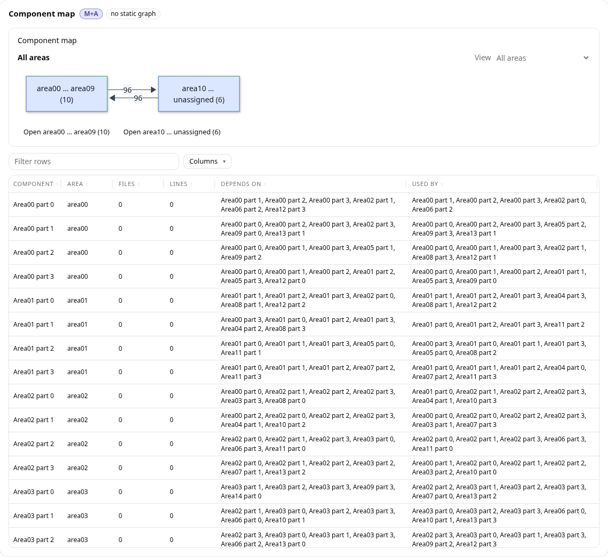

# dossier

A Claude Code skill that reads a git repository and builds one self-contained HTML page of short, cited reports on what the code does, how it is built and where the risks are. Counting and drawing are done by code; Claude reads and writes, and every claim is marked confirmed, inferred or unknown.



The picture is a made-up test page, not a real repository.

## Usage

Inside Claude Code:

```
/dossier home ~/dev/dossiers        # choose where dossiers are saved (once)
/dossier build ~/dev/projects/foo   # build a dossier for a repository
/dossier confirm                    # list open questions, then answer them
/dossier correct                    # record something the dossier got wrong
/dossier doctor ~/dev/projects/foo  # check which tools the repository needs are installed
/dossier check ~/dev/projects/foo   # check the written page in a browser
/dossier clean ~/dev/projects/foo   # delete the working copy and caches for a repository
```

`build` pins the dossier to one commit and writes the page to `<home>/<repo-name>/`. Run it again after the code changes: only the reports that cite changed code are rewritten. Add `--verify` to have an independent checker test a sample of the cited claims.

## Install

Requires Claude Code, [uv](https://docs.astral.sh/uv/) and `git`.

- Node 22.13 or later for TypeScript and JavaScript repositories (16 or later for Python alone).
- The .NET SDK named by the repository's `global.json` (8 or later when there is none) for C# repositories.
- Playwright's Chromium for `/dossier check`: `uv run --with playwright python -m playwright install chromium`.
- `gh` is optional; it adds pull request approvals to the Contributors report.

Pick one:

- **Plugin marketplace** (Claude Code 2.1.275 or later):

  ```sh
  /plugin install dossier --marketplace 1npo/dossier
  ```

  The same in a shell: `claude plugin marketplace add 1npo/dossier`, then `claude plugin install dossier@1npo-tools`.
- **Clone into your skills folder**, for machines that allow only internal plugins. The repository root is the skill root:

  ```sh
  git clone https://github.com/1npo/dossier ~/.claude/skills/dossier
  ```

  Update with `git -C ~/.claude/skills/dossier pull`, or check out a release tag such as `v1.1.0`.
- **Zip**: download `dossier-skill-vX.Y.Z.zip` from the [releases](https://github.com/1npo/dossier/releases) and unzip it into `~/.claude/skills/`.

Do not install it both ways: the marketplace copy wins and the cloned one shows as "Not loaded".

The skill runs only when you type `/dossier ...`. Claude does not start it on its own. Run `/dossier doctor` to see what is missing.

## Goals and status

Gives a lead engineer a working mental model of a repository at one commit, with evidence for each claim. It does not edit the repository, run it as a service or replace reading the code. Status: active. Maintained by one person.

## Documentation

For users, in the [user guide](docs/user-guide.md):

- [Getting started](docs/user-guide.md#getting-started)
- [Usage by task](docs/user-guide.md#usage-by-task)
- [Reference](docs/user-guide.md#reference)
- [Troubleshooting](docs/user-guide.md#troubleshooting)

For contributors, in the [developer guide](docs/developer-guide.md):

- [Getting started](docs/developer-guide.md#getting-started)
- [How to make changes](docs/developer-guide.md#how-to-make-changes)
- [Testing](docs/developer-guide.md#testing)

## License

MIT. See [LICENSE](LICENSE). Bundled third-party libraries in `vendor/` keep their own licenses (`LICENSE.md`, `LICENSE-mermaid`).
